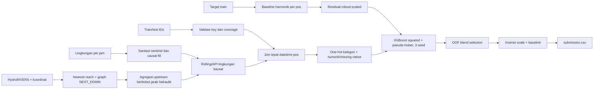

# Arsitektur Model Prediksi Tinggi Muka Air

## 1. Tujuan dan batasan

Pipeline memprediksi `tma_mdpl` untuk 30 pos pada 19 September 2025 hingga 18 Mei 2026, pukul 06.00, 12.00, dan 18.00. Horizon deployment adalah 242 hari atau 21.780 baris.

Model yang dipilih adalah **ensemble XGBoost residual-klimatologi**, bukan CatBoost dan bukan model autoregresif. Kode training telah dibuat, tetapi training belum dijalankan. Karena itu dokumen ini tidak mengklaim skor baru atau kemenangan atas RMSE junior 1,61079 sebelum evaluasi OOF dan submission benar-benar tersedia.

Prinsip desain:

1. validasi harus meniru horizon deployment delapan bulan;
2. tidak ada lag/rolling target karena TMA aktual tidak tersedia selama test;
3. preprocessing hanya memakai informasi yang tersedia pada atau sebelum waktu prediksi;
4. target yang hilang tidak diinterpolasi atau dijadikan pseudo-label;
5. model memisahkan komponen level/musim stabil dari respons lingkungan yang lebih nonlinear;
6. keputusan final ditentukan oleh konsistensi lintas fold, bukan satu split atau training loss.

## 2. Ringkasan audit data

| Sumber | Ukuran dan coverage | Temuan utama |
|---|---:|---|
| Target train | 84.396 baris, 30 pos | 1 Jan 2023 06.00 - 18 Sep 2025 18.00; target finite; tidak ada key duplikat |
| Grid target teoritis | 89.280 baris | 4.884 kombinasi waktu-pos tidak tercatat; tidak diimputasi |
| Test/submission | 21.780 baris | 30 pos x 726 timestamp; ID dan urutan cocok |
| Lingkungan | 888.480 baris, 27 kolom | grid per jam lengkap, 1 Jan 2023 - 18 Mei 2026 |
| Koordinat | 30 baris | set nama pos identik dengan train/test/lingkungan |
| HydroRIVERS AU | 836.472 reach, EPSG:4326 | 14 atribut non-geometri sesuai dokumentasi |

Temuan kualitas penting:

- `rainfall_mm` identik dengan `rainfall_openmeteo_mm` pada seluruh baris. Hanya `rainfall_mm` yang masuk model.
- `solar_radiation_mj_m2` mempunyai 100.080 sentinel `-999`, seluruhnya merupakan missing struktural pada periode masa depan. Fitur solar dan flag missing-nya dikeluarkan dari model agar model tidak belajar identitas rezim/sumber forecast.
- Enam fitur soil/pressure dan lima fitur MJO kosong selama 24 jam terakhir. Nilainya di-forward-fill secara kausal maksimum 24 jam dan status missing awal disimpan.
- `nino_34` kosong pada 1-18 Mei 2026 (12.960 sel). Karena indeks ini lambat/bulanan, digunakan forward-fill kausal maksimum 31 hari dengan missing flag.
- Ada nilai target yang jelas merupakan lonjakan/reset sensor, misalnya Napel `34,95 -> 325,83 -> 34,55`, Jurug `0` pada pos dengan level sekitar 80 mdpl, dan Floodway Bridge C `47` di antara level sekitar 2-5 mdpl.
- Detektor konservatif menandai 21 baris ekstrem. Baris tidak dihapus; bobotnya menjadi 0,02. Episode tinggi yang berlangsung beberapa timestamp tidak ditandai sebagai spike.
- Gunungsari baru memiliki target sejak 13 Agustus 2024, sehingga validasi awal mengecualikannya sampai minimum 90 label tersedia.

## 3. Pelajaran dari handoff CatBoost junior

Handoff junior sudah memakai validasi rolling-origin, fitur lingkungan/hidrologi, robust scaling per pos, dan tidak memakai lag target. Audit OOF menunjukkan:

- pooled raw OOF RMSE sekitar 1,66058 dan MAE 0,62263;
- hanya 12 kemunculan label ekstrem di OOF menaikkan pooled RMSE; setelah 12 kejadian tersebut dikeluarkan untuk diagnosis saja, RMSE menjadi sekitar 1,02846 (label tetap tidak boleh dihapus dari skor resmi);
- fold `sep_2023` paling sulit, terutama perubahan level Wonogiri Dam dan label ekstrem;
- importance final didominasi siklus hari, `nino_34`, statistik suhu 72 jam, serta atribut jaringan/statis;
- prediksi raw target membuat satu learner harus sekaligus mempelajari elevasi absolut pos, klimatologi musiman, dan respons cuaca.

Challenger ini mempertahankan bagian yang benar (long-horizon folds, fitur upstream, causal preprocessing) dan mengubah representasi target serta keluarga model.

## 4. Model yang dipilih

### 4.1 Baseline harmonik per pos

Untuk setiap pos, Ridge regression memodelkan level musiman dengan:

- empat pasangan Fourier tahunan;
- sinus/kosinus jam;
- interaksi musim-jam;
- bobot recency dengan half-life 365 hari, dibatasi minimum 0,05;
- bobot kualitas label.

Baseline tidak menggunakan tren linear tanpa batas, sehingga tidak mengekstrapolasi datum secara liar ke delapan bulan test. Fourier tetap dapat dievaluasi di luar rentang train secara stabil.

### 4.2 Target residual ternormalisasi

Untuk baris pos `s` pada waktu `t`:

```text
baseline(s,t) = harmonic_ridge_s(calendar(t))
residual(s,t) = tma(s,t) - baseline(s,t)
scale(s)      = max(IQR(residual_s) / 1.349, 0.05)
z(s,t)        = residual(s,t) / scale(s)
```

XGBoost memprediksi `z`, bukan TMA absolut. Prediksi akhir:

```text
tma_hat(s,t) = baseline(s,t) + z_hat(s,t) * scale(s)
```

Pemisahan ini mengurangi beban model, mencegah pos dengan elevasi sekitar 140 mdpl mendominasi pos sekitar 1 mdpl, dan memberi jalur eksplisit untuk pola musiman yang harus diekstrapolasi.

### 4.3 Ensemble dua objective

Setiap objective dilatih pada seed 17, 41, dan 83:

1. `reg:squarederror` selaras langsung dengan RMSE;
2. `reg:pseudohubererror` lebih tahan terhadap sensor spike dan heavy tail.

Rata-rata tiga seed dihitung per objective. Bobot blend pseudo-Huber dicari dari OOF pada grid 0,0-1,0. Fungsi seleksi adalah:

```text
clean_RMSE + 0.25 * raw_RMSE
```

`clean_RMSE` hanya mengabaikan label yang ditandai detektor konservatif untuk diagnosis pemilihan blend; `raw_RMSE` tetap menjadi guardrail. Semua metrik raw dan clean disimpan terpisah agar tidak menyamarkan kualitas data.

Hyperparameter awal XGBoost sengaja diregularisasi:

- `learning_rate=0.025`, `max_depth=7`, `min_child_weight=20`;
- `subsample=0.85`, `colsample_bytree=0.80`;
- `reg_lambda=20`, `reg_alpha=0.10`;
- histogram tree, maksimum 5.000 round, early stopping 250 round.

Jumlah round final adalah median `best_iteration + 1` lintas fold untuk masing-masing objective.

## 5. Aliran data



## 6. Preprocessing dan missing value

1. ID test diparse dengan regex timestamp tetap; nama pos yang mengandung tanda hubung tidak rusak.
2. Semua merge memakai validasi cardinality (`one_to_one` atau `many_to_one`).
3. Baris target yang tidak tersedia dibiarkan tidak ada. Tidak ada interpolasi target.
4. Sentinel solar `-999` diubah ke `NaN`, kemudian fitur solar dikeluarkan dari model karena train-test availability shift.
5. Soil/pressure/MJO di-forward-fill per pos maksimum 24 jam. Nino 3.4 maksimum 31 hari. Tidak ada backward-fill.
6. Nilai lingkungan yang masih missing dibiarkan `NaN`; XGBoost mempelajari default missing direction. Flag missing asli tetap tersedia untuk slow variables.
7. Hujan dibatasi minimum nol dan soil moisture ke [0,1] berdasarkan batas fisik, bukan statistik test.
8. Arah angin diubah menjadi sinus/kosinus; MJO phase juga menjadi sinus/kosinus dan kategori.
9. Kategori di-one-hot dengan `handle_unknown=ignore`; numerik tidak diimputasi median secara global.

## 7. Feature engineering

### 7.1 Dinamis lokal

- nilai saat ini: hujan, kelembapan, suhu, dew point, cloud, angin, soil moisture empat lapis, pressure, MJO, Nino 3.4;
- dew-point depression;
- akumulasi hujan trailing 6/24/72/168/336 jam;
- maksimum hujan trailing 24 jam;
- antecedent precipitation index berbasis EWM, half-life 12/48/168 jam;
- mean soil moisture 24/168 jam;
- mean suhu dan kelembapan 24/72 jam;
- mean surface pressure 24 jam.

Semua window right-aligned/causal. Window awal yang belum memiliki histori penuh tetap `NaN`, bukan diisi dari masa depan.

### 7.2 Jaringan sungai

Setiap pos dipasangkan ke reach terdekat dalam UTM 49S. Jarak maksimum sekitar 1,24 km; disimpan `river_distance_m` dan confidence `exp(-distance_m/1000)`.

Atribut HydroRIVERS yang dipakai:

- `NEXT_DOWN` untuk traversal downstream;
- `MAIN_RIV` dan `HYBAS_L12` sebagai kategori basin;
- `LENGTH_KM`, `DIST_DN_KM`, `DIST_UP_KM`;
- `CATCH_SKM`, `UPLAND_SKM`, `DIS_AV_CMS` beserta `log1p`;
- `ORD_STRA`, `ORD_CLAS`, `ORD_FLOW`;
- `ENDORHEIC`.

Untuk target `j`, stasiun sumber `i` menjadi upstream jika reach target ditemukan ketika menelusuri `NEXT_DOWN` dari reach sumber. Bobot:

```text
w(j,i) = exp(-hydraulic_distance(i,j) / 75 km)
```

Bobot dinormalisasi per target. Matriks hasil identik secara numerik dengan matriks handoff junior (selisih maksimum sekitar `1,1e-16`), sehingga implementasi arah graph telah tervalidasi silang.

### 7.3 Kalender dan statis

- Fourier day-of-year dan jam;
- kategori jam dan bulan;
- flag musim hujan November-April;
- latitude/longitude, built surface, land cover;
- atribut reach dan basin HydroRIVERS.

## 8. Validasi untuk generalisasi

Empat rolling-origin fold memakai horizon panjang:

| Fold | Train sampai | Validasi |
|---|---|---|
| sep_2023 | 18 Sep 2023 | 19 Sep 2023 - 18 Mei 2024 |
| may_2024 | 18 Mei 2024 | 19 Mei 2024 - 18 Jan 2025 |
| sep_2024 | 18 Sep 2024 | 19 Sep 2024 - 18 Mei 2025 |
| jan_2025 | 18 Jan 2025 | 19 Jan 2025 - 18 Sep 2025 |

Untuk setiap fold, baseline, residual scale, one-hot encoder, label weights, dan XGBoost di-fit ulang hanya pada prefix train. Pos dengan kurang dari 90 label pada prefix tidak dinilai.

Metrik wajib:

- raw RMSE/MAE/bias/p95 absolute error;
- clean diagnostic RMSE/MAE dengan label ekstrem yang telah ditandai;
- metrik per pos dan worst-station;
- metrik per bulan, jam, dan rezim hujan;
- baseline harmonic-only;
- stabilitas improvement pada semua fold.

Kriteria promosi terhadap CatBoost: challenger harus memperbaiki pooled raw RMSE atau memberikan clean RMSE yang konsisten lebih baik tanpa regresi besar pada satu fold/pos. Jika tidak, jangan mengganti model hanya karena arsitekturnya lebih kompleks.

## 9. Guardrail operasional

- Notebook default menjalankan `MODE = "audit"`, bukan training.
- `validate`, `fit`, dan `all` berhenti kecuali `CONFIRM_TRAIN = True`.
- Feature list menolak nama yang diawali `tma_` atau mengandung `target`.
- Tidak ada recursive TMA, backward-fill, pseudo-label, atau statistik test untuk fit target preprocessing.
- Prediksi harus finite dan urutan ID harus identik dengan sample submission.
- Safety rail final memakai kuantil 0,1%-99,9% per pos ditambah lima residual scale; ini hanya mencegah extrapolation failure ekstrem, bukan clipping ke rentang train biasa.

## 10. Cara menjalankan

Seluruh kode berada di `notebook-150726.ipynb` dengan struktur 25 cell seperti notebook junior.

1. Run All dengan `MODE = "audit"` dan `CONFIRM_TRAIN = False` untuk audit aman.
2. Gunakan `MODE = "prepare"` untuk membangun exact feature matrices tanpa training.
3. Setelah persetujuan training, pilih `MODE = "validate"` dan set `CONFIRM_TRAIN = True`.
4. Gunakan `MODE = "fit"` untuk final fit dari hasil validasi, atau `MODE = "all"` untuk validasi, final fit, dan submission.
5. Gunakan `MODE = "predict"` untuk inference dari model bundle yang sudah tersedia.

Artefak utama:

- `artifacts/audit/data_audit.json`;
- `artifacts/prepared/train_features.parquet` dan `test_features.parquet`;
- `artifacts/prepared/station_hydro_features.csv`;
- `artifacts/prepared/upstream_weights.csv`;
- `artifacts/validation/oof_predictions.parquet`, `metrics.csv`, `station_metrics.csv`, `residual_slices.csv`, `blend_search.csv`, `summary.json`;
- `artifacts/model/forecast_bundle.joblib`, metadata, dan feature importance;
- `artifacts/submission.csv`.

## 11. Risiko dan eksperimen lanjutan

- Hanya sekitar 2,7 tahun target tersedia; deep temporal model/GNN end-to-end belum menjadi pilihan utama karena hanya 30 node dan rollout sangat panjang.
- Level reservoir/dam dapat berubah akibat operasi manusia yang tidak terwakili cuaca. Per-pos residual bias pada fold harus dipantau.
- Missing solar pada test sangat besar. Fitur sengaja dikeluarkan; ablation boleh membandingkan proxy solar deterministik, tetapi jangan menggunakan missing flag sebagai penanda waktu test.
- Ensemble enam model meningkatkan runtime. Setelah OOF, seed atau objective dapat dipangkas bila gain tidak material.
- Jika XGBoost gagal mengungguli CatBoost, kandidat berikutnya adalah blend OOF antara model residual ini dan model linear/GAM residual yang lebih sederhana, tetap tanpa lag target.
