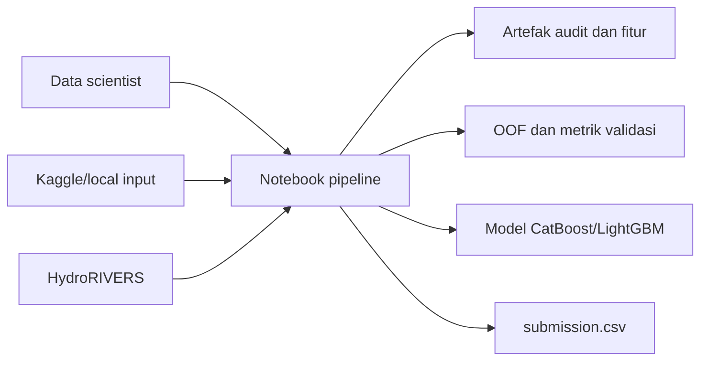
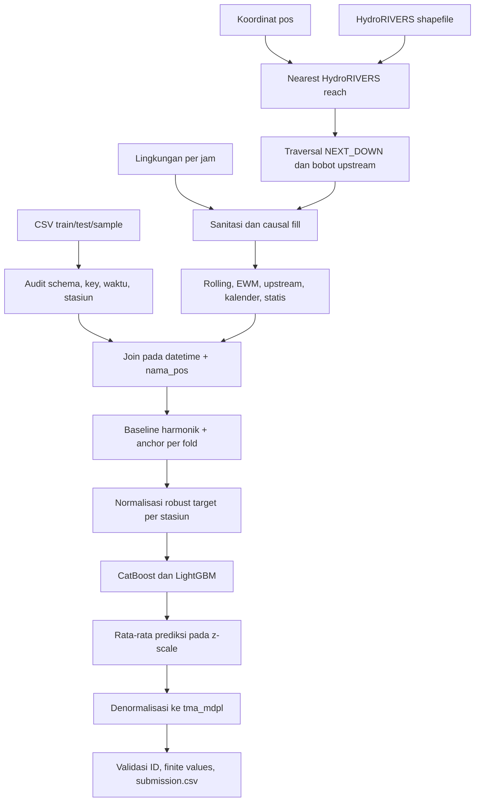

# Architecture — Prediksi Tinggi Muka Air Sungai

## 1. Konteks dan prinsip desain

Sistem memprediksi `tma_mdpl` untuk 30 stasiun pada horizon 242 hari. Setiap hari memiliki tiga waktu target: 06.00, 12.00, dan 18.00. Karena TMA aktual tidak tersedia sepanjang horizon test, arsitektur utama bersifat **exogenous, non-recursive, dan station-aware**.

Prinsip yang diterapkan:

- fitur prediksi harus tersedia pada atau sebelum waktu prediksi;
- label yang hilang tidak diinterpolasi atau dijadikan pseudo-label;
- validasi memakai horizon panjang yang menyerupai deployment;
- preprocessing berbasis target di-fit ulang pada prefix training setiap fold;
- perbedaan elevasi dan skala antar-stasiun ditangani dengan normalisasi robust;
- relasi hulu-hilir berasal dari graf sungai, bukan hanya jarak geografis;
- setiap run menyimpan konfigurasi, log, metrik, model, dan manifest.

Dokumen ini menjadikan `notebookfde8c8db98.ipynb` sebagai arsitektur utama terkini. Implementasi lain dibahas sebagai baseline atau challenger pada bagian 13.

## 2. Diagram konteks



Pipeline adalah sistem batch. Tidak terdapat API inference, database, message queue, atau online feature store.

## 3. Komponen logis

| Komponen | Fungsi utama | Implementasi utama |
|---|---|---|
| Input contract | Memuat CSV, parse ID, memeriksa schema dan coverage | `load_inputs`, `parse_submission_ids`, `audit_inputs` |
| Spatial topology | Memetakan stasiun ke river reach dan membangun bobot upstream | `_read_local_rivers`, `match_stations_to_rivers`, `build_upstream_weights` |
| Environmental features | Sanitasi, causal fill, transformasi, rolling dan EWM | `prepare_environment`, `_add_upstream_environment` |
| Static/calendar features | Kalender, kategori, koordinat, atribut HydroRIVERS | `add_calendar_and_categories`, `build_feature_tables` |
| Station features | Baseline harmonik dan anchor anomali per pos | `fit_harmonic_baselines`, `apply_station_features`, `add_anchor_features` |
| Target processing | Center dan scale robust per pos | `fit_target_stats`, `normalize_target`, `denormalize_prediction` |
| Model layer | Factory, fit, predict, feature importance | `build_model`, `fit_member`, `predict_member` |
| Evaluation | Rolling-origin folds dan metrik global/per-pos | `run_validation`, `metrics_frame` |
| Experimentation | Ablation dan sweep hyperparameter ringan | `run_ablation_study`, `run_hyperparam_sweep` |
| Finalization | Ensemble final, quantile opsional, submission | `fit_final_and_submit`, `fit_quantile_model` |
| Run management | Manifest, log, inventory, handoff ZIP | `create_run_directory`, `update_manifest`, `create_handoff_zip` |
| Orchestration | Memilih mode dan menghubungkan seluruh tahap | `run_pipeline` |

## 4. Kontrak input

### 4.1 File wajib

```text
<DATA_DIR>/
├── train.csv
├── test.csv
├── sample_submission.csv
└── data_pendukung/
    ├── koordinat_pos.csv
    ├── data_lingkungan.csv
    └── HydroRIVERS_v10_au_shp/
        ├── HydroRIVERS_v10_au.shp
        ├── HydroRIVERS_v10_au.dbf
        ├── HydroRIVERS_v10_au.shx
        └── HydroRIVERS_v10_au.prj
```

`sample_submission.csv` diwajibkan walaupun tidak tersedia di workspace lokal saat dokumentasi dibuat.

### 4.2 Schema inti

| Dataset | Kolom kunci | Kolom nilai |
|---|---|---|
| Train | `datetime`, `nama_pos` | `tma_mdpl` |
| Test | `id` | Timestamp dan nama pos diparse dari ID |
| Sample submission | `id` | Kolom target template |
| Lingkungan | `datetime`, `nama_pos` | 25 fitur lingkungan/statis lain |
| Koordinat | `nama_pos` | `latitude`, `longitude` |

Format ID test:

```text
YYYY-MM-DD HH:MM:SS - <nama_pos>
```

Regex memisahkan timestamp dengan pola tetap dan mengambil seluruh sisa string sebagai nama pos. Hal ini mencegah nama stasiun yang mengandung ` - ` terpotong.

### 4.3 Guardrail audit

Pipeline menghentikan proses bila:

- schema train berubah;
- key `(datetime, nama_pos)` duplikat;
- target memiliki `NaN` eksplisit;
- ID test duplikat atau urutannya berbeda dari sample submission;
- set stasiun berbeda antar-sumber;
- jam target di luar 06, 12, 18;
- grid lingkungan per jam tidak lengkap untuk setiap stasiun.

Join utama memakai validasi cardinality Pandas (`many_to_one` atau `one_to_one`).

## 5. Aliran data end-to-end



## 6. Feature engineering

### 6.1 Sanitasi lingkungan

- `rainfall_openmeteo_mm` harus identik dengan `rainfall_mm`, lalu salah satunya dibuang.
- Sentinel radiasi surya `<= -900` diubah menjadi `NaN` dan dibuat flag missing.
- Missing indicator dibuat untuk soil moisture, pressure, MJO, dan Nino 3.4.
- Fitur state jangka pendek di-forward-fill per pos maksimum 24 jam.
- `nino_34` di-forward-fill secara kausal maksimum 31 hari.
- Tidak ada backward-fill.
- Hujan dibatasi minimum nol; soil moisture dibatasi ke rentang `[0, 1]`.
- Arah angin diubah ke sinus dan kosinus.
- `dewpoint_depression_c = temperature_c - dew_point_c`.

### 6.2 Fitur temporal dinamis

Untuk hujan lokal dan hujan upstream:

- rolling sum 6, 24, 72, 168, dan 336 jam;
- rolling maximum 24 jam;
- antecedent precipitation index berbasis EWM dengan half-life 12, 48, dan 168 jam.

Untuk state lain:

- mean soil moisture 24 dan 168 jam;
- mean suhu dan kelembapan 24 dan 72 jam;
- mean surface pressure 24 jam.

Window bersifat right-aligned pada urutan waktu. Minimum observation pada rolling window dipakai untuk menjaga baris awal tetap dapat dihitung tanpa melihat masa depan.

### 6.3 Fitur spasial dan hidrologi

Setiap stasiun dipasangkan ke reach HydroRIVERS terdekat. Atribut numerik yang dapat digunakan meliputi panjang reach, jarak upstream/downstream, luas catchment/upstream, discharge rata-rata, dan orde sungai.

Hubungan upstream ditentukan dengan menelusuri `NEXT_DOWN`. Untuk pasangan sumber upstream `i` dan target `j`, bobot dasarnya:

```text
w(j, i) = exp(-hydraulic_distance(i, j) / 75 km)
```

Bobot dinormalisasi per stasiun target. Pipeline mengagregasi paling tidak hujan dan soil moisture permukaan dari stasiun upstream.

### 6.4 Kalender dan kategori

Fitur mencakup representasi siklik waktu, kategori jam/bulan, musim hujan, identitas stasiun, land cover, basin/main river, dan atribut statis stasiun/reach. CatBoost menerima kategori secara native; LightGBM mengonversinya ke categorical codes yang konsisten antara fit dan inference.

### 6.5 Fitur baseline harmonik dan anchor

Baseline harmonik Ridge di-fit terpisah per pos menggunakan data prefix training. Fitur ini menangkap pola tahunan dan intrahari yang dapat diekstrapolasi stabil.

Anchor menyimpan anomali TMA terbaru terhadap baseline harmonik pada window 30 hari sebelum cutoff. Pengaruhnya meluruh terhadap horizon:

```text
anchor_basis = exp(-abs(horizon_days) / 365) * recent_anomaly
```

Baseline dan anchor dihitung di dalam setiap fold, bukan saat feature table global dibangun. Placeholder global dibiarkan `NaN` sampai cutoff fold diketahui agar tidak terjadi leakage.

## 7. Target dan pembobotan

Untuk setiap stasiun `s`:

```text
center(s) = median(tma_s)
scale(s)  = max((Q75(tma_s) - Q25(tma_s)) / 1.349, 0.05)
z(s,t)    = (tma(s,t) - center(s)) / scale(s)
```

Model memprediksi `z`. Prediksi final dikembalikan dengan:

```text
tma_hat(s,t) = center(s) + z_hat(s,t) * scale(s)
```

Normalisasi di-fit ulang pada subset training masing-masing fold. Detektor spike terisolasi tersedia untuk menurunkan bobot label ekstrem tanpa menghapus baris. Pada konfigurasi run utama yang tersimpan, `USE_SPIKE_WEIGHTS = False`, sesuai hasil ablation yang belum menunjukkan keuntungan RMSE konsisten dari pembobotan spike.

## 8. Layer model dan ensemble

Ensemble default terdiri dari lima learner heterogen:

| Anggota | Family | Karakter |
|---|---|---|
| `cb_shallow` | CatBoost | Depth lebih dangkal, learning rate lebih tinggi |
| `cb_base` | CatBoost | Konfigurasi baseline |
| `cb_deep` | CatBoost | Regularisasi/depth berbeda |
| `lgbm_a` | LightGBM | Leaf-wise boosting dengan subsampling |
| `lgbm_b` | LightGBM | Variasi leaves, learning rate, dan sampling |

CatBoost memakai objective Huber pada target ternormalisasi. Anggota LightGBM menggunakan konfigurasi boosting yang kompatibel dengan target yang sama. Keragaman family dan kapasitas bertujuan mengurangi bias struktural, bukan hanya variasi seed.

Prediksi anggota dirata-ratakan dengan bobot sama pada z-scale. Belum ada meta-learner atau optimasi bobot ensemble berbasis OOF pada pipeline utama.

Model quantile CatBoost untuk level 0,1/0,5/0,9 tersedia sebagai opsi, tetapi default-nya nonaktif dan keluarannya terpisah dari submission utama.

## 9. Validasi

Empat fold rolling-origin digunakan:

| Fold | Training sampai | Validasi |
|---|---|---|
| `sep_2023` | 18 Sep 2023 18.00 | 19 Sep 2023–18 Mei 2024 |
| `may_2024` | 18 Mei 2024 18.00 | 19 Mei 2024–18 Jan 2025 |
| `sep_2024` | 18 Sep 2024 18.00 | 19 Sep 2024–18 Mei 2025 |
| `jan_2025` | 18 Jan 2025 18.00 | 19 Jan 2025–18 Sep 2025 |

Stasiun baru dinilai setelah memiliki minimal 90 label pada prefix training. Untuk setiap fold:

1. fit subset dipilih berdasarkan cutoff;
2. target stats, baseline harmonik, recent anomaly, dan sample weight di-fit dari subset tersebut;
3. kelima anggota dilatih dengan early stopping;
4. prediksi ensemble dihitung pada z-scale;
5. prediksi didenormalisasi dan dibandingkan dengan target asli;
6. metrik, OOF, per-station error, residual slices, dan feature importance disimpan.

Metrik utama adalah RMSE. Pipeline juga menyimpan MAE, macro-station MAE, worst-station MAE, p95 absolute error, dan baseline musiman. Iterasi final per anggota adalah median best iteration dari fold yang valid.

## 10. Mode orkestrasi

| Mode | Data/features | Training | Output utama |
|---|---|---|---|
| `audit` | Audit input saja | Tidak | Dictionary audit |
| `tune` | Feature table penuh | CatBoost tunggal, satu fold | `hyperparam_sweep.csv` |
| `ablation` | Feature table penuh | LightGBM tunggal, dua fold terbaru | `ablation_results.csv` |
| `validate` | Feature table + handoff | Ensemble × 4 fold | OOF, metrik, rekomendasi iterasi |
| `fit` | Feature table + handoff | Ensemble final | Model dan submission |
| `all` | Seluruh tahap | Validasi + final fit | Handoff lengkap dan submission |

Urutan eksperimen yang direkomendasikan oleh notebook adalah:

```text
audit → tune → validate → ablation → fit/all
```

Feature pruning membutuhkan `feature_importance.csv` dari run validasi sebelumnya. Bila file tidak ditemukan, pipeline mempertahankan semua fitur dan mencatat warning.

## 11. Artefak dan observability

Run berat membuat direktori:

```text
<OUTPUT_DIR>/handoff_<UTC_TIMESTAMP>_<mode>/
```

Isi utamanya:

```text
manifest.json
config.json
runtime_versions.json
input_inventory.json
data_audit.json
feature_columns.json
feature_pruning_report.json
run.log
data/
├── train_features.parquet|csv.gz
├── test_features.parquet|csv.gz
├── target_normalization.csv
├── upstream_station_weights.csv
└── train_sample_diagnostics.parquet|csv.gz
metrics/
├── oof_predictions.parquet|csv.gz
├── validation_metrics.csv
├── member_metrics.csv
├── fold_station_metrics.csv
├── residual_slices.csv
├── feature_importance.csv
└── final_feature_importance.csv
models/
├── catboost_*.cbm
└── lightgbm_*.joblib
training_progress/
submission.csv
submission_quantiles.csv              # opsional
result_summary.json
```

ZIP berstatus `in_progress`, `complete`, atau `failed` dibuat agar run parsial tetap dapat diperiksa. Exception menghasilkan `error_traceback.txt` dan manifest berstatus gagal.

## 12. Deployment target

Deployment saat ini adalah batch inference di Kaggle atau notebook lokal:

1. seluruh model final di-fit pada train lengkap;
2. fitur test dibangun dari data eksogen yang telah tersedia;
3. prediksi lima anggota dirata-ratakan;
4. hasil didenormalisasi per stasiun;
5. output di-join kembali ke ID sample submission secara one-to-one;
6. pipeline menolak submission dengan nilai hilang/non-finite;
7. `submission.csv` ditulis tanpa mengubah urutan ID.

Tidak ada serving online atau proses refresh model otomatis.

## 13. Arsitektur alternatif di workspace

### 13.1 CatBoost optimized v2

`notebook-optimized.ipynb` menguji dua objective CatBoost (RMSE dan Huber), recency weighting, anomaly flag pada validation, dan GPU auto-detection. Implementasi ini memiliki guard `CONFIRM_TRAIN`, tetapi bukan notebook utama paling baru.

### 13.2 XGBoost residual-klimatologi

`xgboost/xgboostibra.ipynb` memisahkan TMA menjadi baseline harmonik per pos dan residual robust-scaled. Ensemble XGBoost square-error dan pseudo-Huber memprediksi residual; bobot blend dipilih dari OOF. Kategori di-one-hot dan model/bundle disimpan dengan Joblib.

Challenger ini memiliki arsitektur modular berbasis dataclass dan artefak OOF lokal, tetapi metrik antar-fold masih tidak stabil. Promosi ke pipeline utama harus memakai fold dan kontrak evaluasi yang identik.

### 13.3 EDA

`EDA/EDA.ipynb` mencakup distribusi/outlier per pos, tren musiman, ACF/PACF, korelasi antar-pos, audit data eksogen, leakage temporal, overlap train-test, peta pos, topologi sungai, dan data statis. Hasil plot tersimpan di `EDA/output_eda/`.

## 14. Keputusan arsitektur penting

| Keputusan | Alasan | Konsekuensi |
|---|---|---|
| Tidak memakai lag TMA | Horizon test panjang tanpa observasi aktual | Menghindari recursive error, tetapi kehilangan sinyal persistence langsung |
| Rolling-origin panjang | Meniru pola deployment | Training lebih mahal, estimasi generalisasi lebih realistis |
| Robust scaling per pos | Elevasi/skala stasiun sangat berbeda | Satu model dapat belajar lintas-pos dengan loss lebih seimbang |
| Upstream graph dari HydroRIVERS | Jarak geografis tidak menjamin arah aliran | Feature engineering lebih kompleks dan bergantung pada shapefile |
| Causal fill saja | Mencegah future leakage | Sebagian nilai tetap `NaN` dan harus ditangani model |
| Ensemble lintas-family | Mengurangi bias model tunggal | Runtime, dependency, dan ukuran artefak bertambah |
| Notebook-first | Cepat untuk eksperimen Kaggle | Sulit diuji, di-package, dan dijalankan otomatis |

## 15. Risiko teknis dan debt

### Risiko data/model

- Drift availability fitur antara train dan test dapat menjadi shortcut temporal.
- Spike sensor dapat mendominasi RMSE walaupun jumlahnya sedikit.
- Fold `sep_2023` jauh lebih sulit daripada fold lain, menandakan regime shift atau kualitas label berbeda.
- Operasi manusia pada bendungan tidak dijelaskan oleh cuaca dan topologi.
- Estimasi topologi bergantung pada nearest reach; salah snap dapat membalik interpretasi upstream.

### Risiko operasional

- `MODE` notebook utama saat ini tersimpan sebagai `all`, bukan default aman `audit`.
- `sample_submission.csv` tidak ada secara lokal.
- Data lokal berada di root, sedangkan default lokal menunjuk `datasets/`.
- `requirements.txt` belum mencantumkan LightGBM, XGBoost, Joblib, PyArrow, Jupyter, dan dependency EDA.
- Artefak run Kaggle utama tidak disalin ke repository.
- Tidak ada automated test atau CI.
- Beberapa versi notebook dapat membingungkan pemilihan source of truth.

## 16. Target arsitektur berikutnya

```text
src/tma_forecasting/
├── config.py
├── data.py
├── topology.py
├── features.py
├── targets.py
├── models.py
├── validation.py
├── artifacts.py
└── pipeline.py
tests/
configs/
notebooks/
artifacts/                 # di-ignore atau disimpan di object storage
```

Prioritas refactor:

1. tetapkan satu source of truth dan jadikan notebook hanya sebagai runner/analisis;
2. buat konfigurasi environment dan mode di luar notebook;
3. tambahkan unit test untuk transformasi kausal dan kontrak submission;
4. versioning dataset, feature schema, dan model artifact;
5. sediakan CLI seperti `python -m tma_forecasting.pipeline --mode audit`;
6. tambahkan perbandingan OOF otomatis antara incumbent dan challenger;
7. simpan artefak final ke lokasi persisten dengan checksum dan metadata run.

